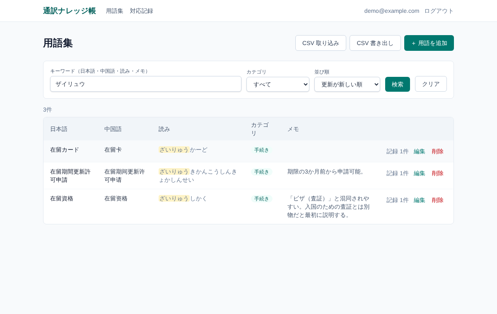
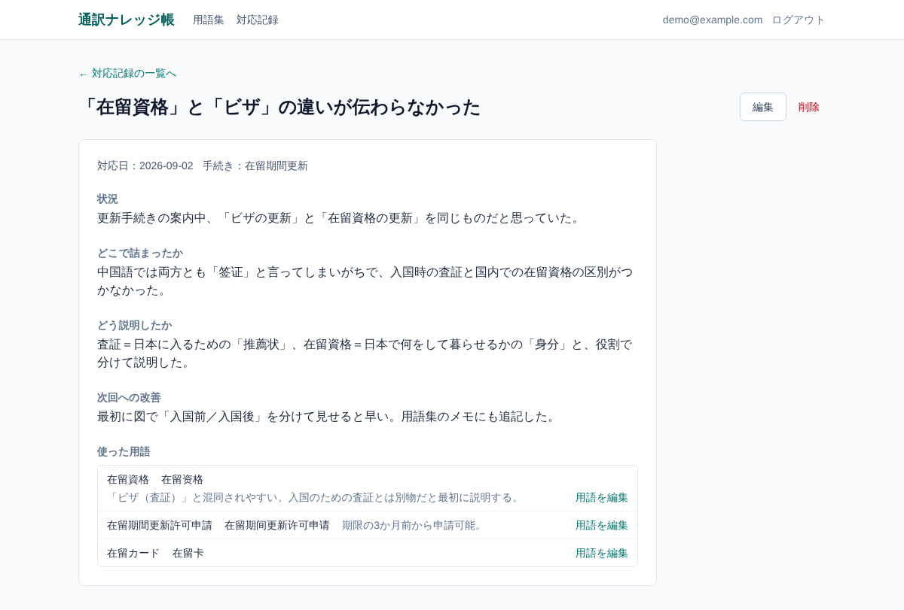
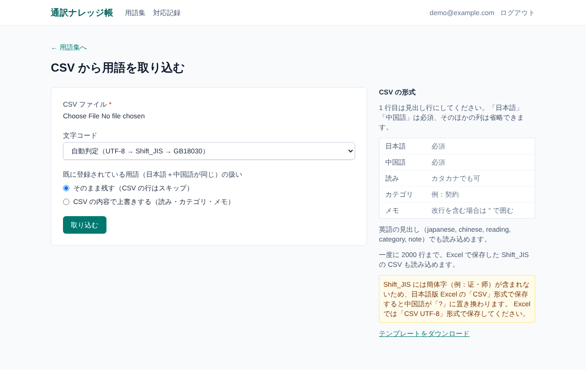
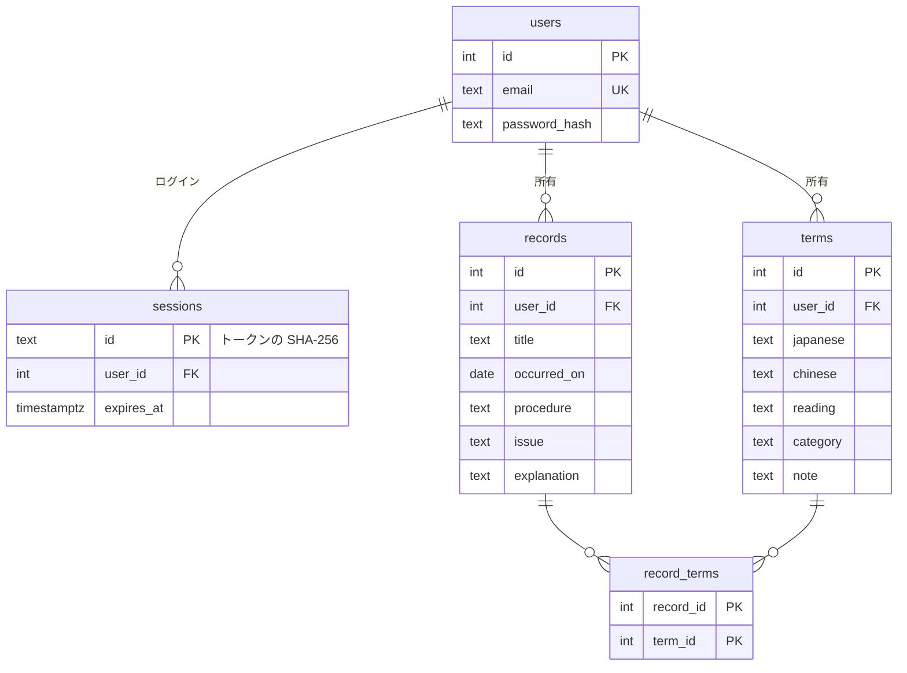

# 通訳ナレッジ帳

中日通訳のための **用語集** と **対応記録** を管理する Web アプリです。
「どの手続きで、どこで詰まり、どう説明したか」を用語と結びつけて残し、次の現場に生かすことを目的にしています。

- デモ: https://legalcasestudy2026.vercel.app
- デモ用アカウント: `demo@example.com` / `demo-pass-2026`（データはすべて架空です）



## なぜ作ったか

> ※ここは自分の言葉で書き直してください（下は骨組みです）

- 通訳の現場では、同じ手続き・同じ用語で何度も説明に詰まる場面があった
- 用語はメモ帳や Excel に散らばっていて、現場ですぐに引けなかった
- 「どう説明したら伝わったか」は個人の頭の中にしか残らず、次に生かせていなかった
- そこで、用語集と対応記録を 1 か所にまとめ、検索できる仕組みを作った

## 主な機能

| 機能           | 内容                                                                                                            |
| -------------- | --------------------------------------------------------------------------------------------------------------- |
| 用語集         | 日本語・中国語・読み・カテゴリ・メモの登録／編集／削除                                                          |
| 検索・絞り込み | 日本語・中国語・読み・メモを部分一致で検索。スペース区切りで AND 検索。カテゴリで絞り込み、並び替え、ページ送り |
| 表記ゆれ対策   | 「ザイリュウ」「ｻﾞｲﾘｭｳ」「ざいりゅう」のどれでも読みにヒット。全角英数字も半角にそろえる                        |
| 対応記録       | 件名・対応日・手続きの種類・状況・詰まったところ・どう説明したか・次回への改善を記録。使った用語を関連づけ      |
| 用語 ⇔ 記録    | 記録から用語へ、用語一覧から「その用語を使った記録」へ移動できる                                                |
| ログイン       | メールアドレスとパスワードで登録・ログイン。自分のデータだけが見える                                            |
| CSV            | 用語の一括取り込み（Shift_JIS／GB18030 も自動判定）と書き出し（Excel で文字化けしない）                         |
| スマートフォン | 一覧は画面幅に応じてカード表示に切り替え                                                                        |

| 対応記録                                   | CSV 取り込み                                |
| ------------------------------------------ | ------------------------------------------- |
|  |  |

## 技術構成

| 分類                  | 使用技術                                           |
| --------------------- | -------------------------------------------------- |
| フロントエンド        | React 19 / TypeScript / Tailwind CSS               |
| フレームワーク        | Next.js 16（App Router, Server Actions）           |
| データベース          | PostgreSQL（本番は Neon または Supabase の無料枠） |
| ORM・マイグレーション | Drizzle ORM / drizzle-kit                          |
| バリデーション        | zod                                                |
| CSV                   | Papa Parse                                         |
| テスト・品質          | Vitest / ESLint / Prettier / GitHub Actions        |
| デプロイ              | Vercel                                             |

### 技術選定の理由

- **Next.js**: 画面とサーバー処理を 1 つのプロジェクトで書け、Vercel にそのままデプロイできる。Server Actions を使うと、フォーム送信のための API を別に作らずに済む
- **PostgreSQL**: 用語と記録の多対多、ユーザーごとの一意制約、トランザクションなど、リレーショナルな機能が必要だったため
- **Drizzle ORM**: SQL に近い書き方で、どんな SQL が実行されるかを把握しやすい。スキーマから TypeScript の型が自動で付く
- **認証は自作（ライブラリ不使用）**: 学習のため、パスワードのハッシュ化とセッション管理の仕組みを理解したうえで実装した（詳しくは下の「工夫した点」）

## データベース設計



- `terms` には `(user_id, japanese, chinese)` の一意制約。同じ用語の二重登録を防ぎ、CSV 取り込み時の重複判定にも使う
- 記録と用語は多対多なので中間テーブル `record_terms` を用意。どちらかを削除すると関連も自動で消える（`ON DELETE CASCADE`）
- カテゴリは別テーブルにせず文字列で持った。個人用で種類が少なく、自由に増やせるほうが使いやすいため

## 工夫した点

1. **検索の表記ゆれ対策** — 入力を NFKC 正規化し、読みはひらがなに統一して保存。検索語も同じ変換をかけてから比較する。`%` や `_` を含む検索語でも正しく動くよう LIKE 用にエスケープしている
2. **ユーザーごとのデータ分離** — すべてのページと Server Action の先頭でログインを確認し、SQL の条件に必ず `user_id` を含める。URL の ID を書き換えても他人のデータは 404 になる。記録に紐づける用語 ID も「自分の用語か」をサーバー側で確認している
3. **認証まわりの安全性** — パスワードは scrypt（ソルト付き）でハッシュ化し定数時間で比較。セッショントークンは httpOnly・SameSite=Lax のクッキーに入れ、DB にはハッシュだけを保存。ログイン失敗時は「メールアドレスまたはパスワードが違います」とだけ表示する
4. **CSV 取り込みは「全部か、何もしないか」** — 1 行でもエラーがあれば取り込まず、行番号つきでエラーを一覧表示。一部だけ入って状態が分からなくなるのを防ぐ
5. **CSV の書き出し** — BOM 付き UTF-8 で Excel でも文字化けしない。`=` などで始まるセルは数式として実行されないようエスケープ（CSV インジェクション対策）

## 苦労した点・気づいたこと

- **Shift_JIS では簡体字が表現できない** — 日本語版 Excel で「CSV」形式で保存すると Shift_JIS になり、「证」「师」などの簡体字が「?」に化ける。文字コードの自動判定を入れたうえで、画面に「CSV UTF-8 形式で保存してください」と注意書きを出した
- **ON CONFLICT で同じ行を 2 回更新できない** — CSV に同じ用語が 2 行あると、PostgreSQL の `INSERT ... ON CONFLICT DO UPDATE` がエラーになる。取り込み前にファイル内の重複をまとめ、「後の行を採用した」ことを画面で知らせるようにした
- **一覧ページがビルド時に静的生成されてしまう** — Next.js はリクエスト固有の情報を使わないページをビルド時に HTML にしてしまうため、DB の更新が反映されなかった。ログイン確認（クッキーの読み取り）を入れたことで、リクエストごとに描画されるようになった
- **NFKC 正規化の副作用** — メモ欄まで正規化すると全角の「（）」が半角になってしまった。検索に使う用語の欄だけ正規化し、メモは入力どおりに保存するよう分けた
- **フォームのエラー時に入力が消える** — React 19 ではフォーム送信後に入力欄がリセットされるため、Server Action から送信値を返して再表示するようにした

## ディレクトリ構成

```
src/
├── app/
│   ├── (auth)/            ログイン・新規登録と、その Server Action
│   ├── terms/             用語集（一覧・検索、追加、編集、CSV 取り込み・書き出し）
│   ├── records/           対応記録（一覧、詳細、追加、編集）
│   └── layout.tsx         共通ヘッダー
├── components/            共通 UI（ボタン、入力欄、削除ボタン、ハイライト）
├── db/
│   ├── schema.ts          テーブル定義（ここから型とマイグレーションを生成）
│   └── index.ts           DB 接続
└── lib/
    ├── auth/              パスワードのハッシュ化、セッション管理
    ├── csv.ts             CSV の読み込み・書き出し
    ├── search.ts          検索語の分割・エスケープ
    ├── text.ts            表記ゆれの正規化
    └── validation.ts      入力チェック（zod）
drizzle/                   マイグレーション SQL
scripts/seed.ts            デモ用データの投入
```

## ローカルで動かす

必要なもの: Node.js 20.9 以上、PostgreSQL

```bash
npm install
cp .env.example .env          # DATABASE_URL を自分の環境に合わせる
npm run db:migrate            # テーブル作成
npm run db:seed               # デモユーザーとサンプルデータ（任意）
npm run dev                   # http://localhost:3000
```

| コマンド                                                      | 内容                                              |
| ------------------------------------------------------------- | ------------------------------------------------- |
| `npm test`                                                    | 単体テスト（正規化・検索・CSV・パスワード）       |
| `npm run lint` / `npm run typecheck` / `npm run format:check` | 静的チェック                                      |
| `npm run db:generate`                                         | `schema.ts` の変更からマイグレーション SQL を生成 |

## デプロイ（Vercel + Neon）

1. [Neon](https://neon.tech) でプロジェクトを作成し、接続文字列（`postgres://...`）をコピー
2. 手元で `DATABASE_URL=<Neon の接続文字列> npm run db:migrate`（必要なら `db:seed` も）
3. [Vercel](https://vercel.com) で GitHub リポジトリをインポートし、環境変数 `DATABASE_URL` を設定してデプロイ

Supabase を使う場合も、接続文字列を差し替えるだけで動きます（コネクションプーラー対策で `prepare: false` を設定済み）。

## 今後やりたいこと

- 簡体字・繁体字のゆれ（例：证／證）でも検索できるようにする
- 用語が増えたときのために `pg_trgm` インデックスで部分一致検索を高速化
- ログイン試行回数の制限、パスワード再設定
- 対応記録の集計（よく詰まる手続き・用語のランキング）
